# Water Management System: AWS Infrastructure

Infrastructure and deployment setup for a full-stack water-billing platform (React, Spring Boot, PostgreSQL). The application was built as a university group project. I was the DevOps owner for its AWS deployment: Terraform infrastructure, CI/CD, GitOps, monitoring and logging.

> **Status:** deployed and tested on AWS, then torn down to save cost. Demo video: <paste link here>

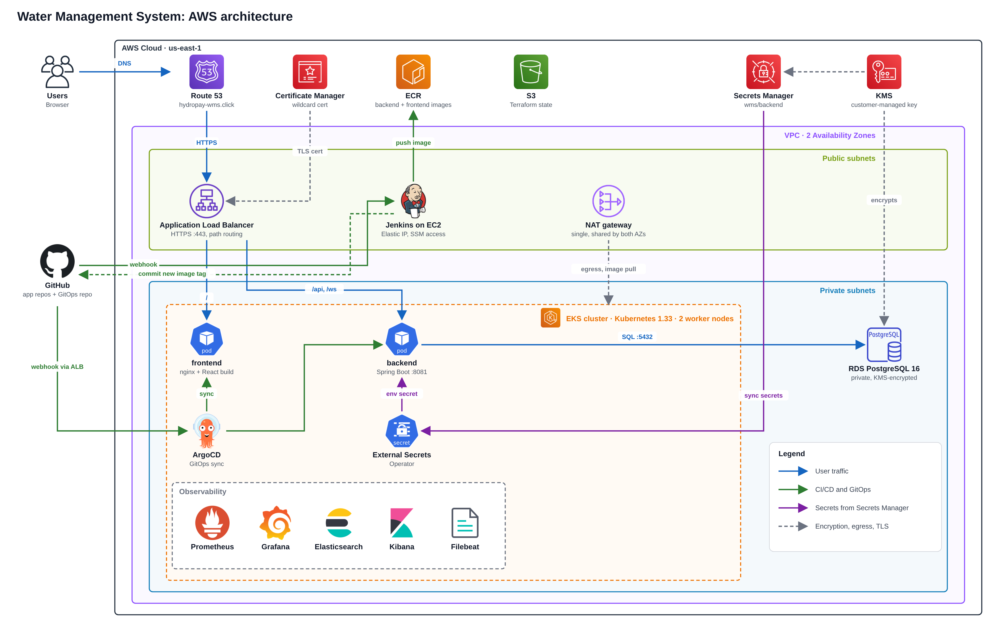

## How it works

1.A push to the backend or frontend repo triggers Jenkins through a GitHub webhook.
2.Jenkins builds the Docker image, scans it with Trivy, pushes it to ECR and commits the new image tag to a separate GitOps repo.
3.ArgoCD (also webhook-triggered) syncs the GitOps repo to EKS with a rolling update. There is no manual kubectl apply for the app.
4.The domain hydropay-wms.click is bought on Namecheap and pointed at AWS Route 53 using custom nameservers. Users reach the site through Route 53, then an ALB with an ACM certificate (HTTPS), then the frontend (nginx) and backend (Spring Boot).
5.The backend talks to a private Amazon RDS PostgreSQL database. Only the cluster can reach it, and it is encrypted with a customer-managed KMS key.
6.Credentials live in AWS Secrets Manager, including the RDS-managed database password. The External Secrets Operator syncs them into the cluster, so nothing secret is stored in Git.
7.Prometheus and Grafana monitor the cluster, nodes and pods. Filebeat ships the application logs to Elasticsearch, and Kibana is used to search them.
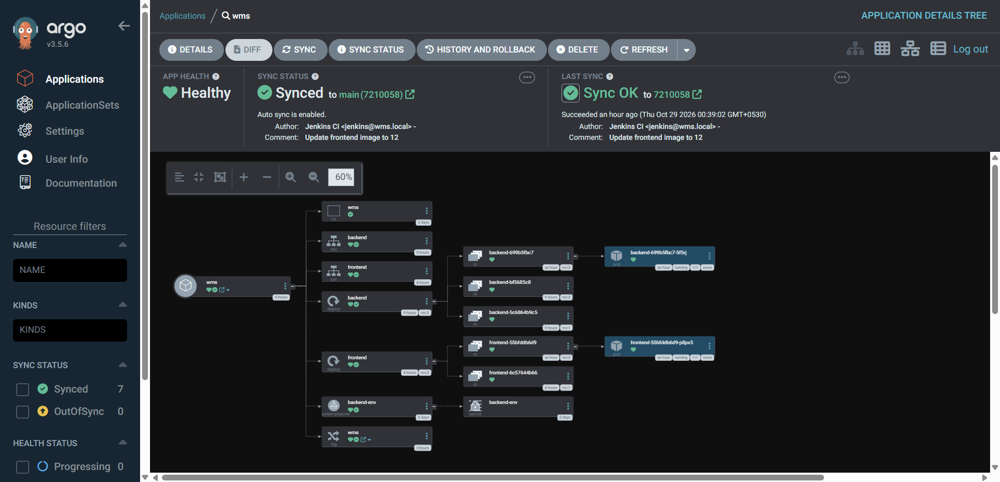

## Stack

| Layer | What |
|---|---|
| Network | VPC across 2 AZs, private subnets, single NAT gateway, S3 gateway endpoint |
| Compute | EKS 1.33, managed node group (2 nodes) |
| Database | RDS PostgreSQL 16, private, encrypted with a customer-managed KMS key |
| Secrets | AWS Secrets Manager, External Secrets Operator, IRSA (no static AWS keys) |
| Registry | ECR repositories with scan on push |
| CI | Jenkins on EC2, GitHub-webhook-triggered pipelines, Trivy scan |
| CD | ArgoCD, automated sync with prune and self-heal |
| Ingress / TLS | AWS Load Balancer Controller, one shared ALB, ACM wildcard certificate, Route 53 |
| Monitoring | kube-prometheus-stack (Prometheus, Grafana) |
| Logging | Elasticsearch, Kibana and Filebeat via the ECK operator |

## Repositories

| Repo | Contents |
|---|---|
| `water-management-system-infra` (this repo) | Terraform and one-time cluster bootstrap files in `k8s/` |
| `water-management-system-gitops` | Kubernetes manifests that ArgoCD syncs |
| `water-management-system-backend` | Spring Boot app, Dockerfile, Jenkinsfile |
| `water-management-system-frontend` | React app, Dockerfile, nginx.conf, Jenkinsfile |

## What is in this repo

```
*.tf                        Terraform: VPC, EKS, RDS, KMS, Secrets Manager, ECR, Jenkins, IAM, ACM, Route 53
k8s/argocd-values.yaml      Helm values for ArgoCD
k8s/argocd-app.yaml         ArgoCD Application pointing at the GitOps repo
k8s/argocd-ingress.yaml     Public ingress for the ArgoCD webhook endpoint only
k8s/monitoring-values.yaml  kube-prometheus-stack values
k8s/logging.yaml            Elasticsearch, Kibana, Filebeat (ECK)
```

## Deployment steps

1. `terraform apply` creates the network, cluster, database, registry, Jenkins server and DNS.
2. Install the cluster add-ons with Helm: AWS Load Balancer Controller, External Secrets Operator, ArgoCD.
3. `kubectl apply -f k8s/argocd-app.yaml` points ArgoCD at the GitOps repo, and it deploys the app.
4. Install monitoring (`helm install monitoring ...` with `k8s/monitoring-values.yaml`) and logging (`kubectl apply -f k8s/logging.yaml` after installing the ECK operator).

## CI/CD in practice

Two Jenkins pipelines (one per repo), each with the stages Checkout, Build image, Trivy scan, Push to ECR and Update GitOps repo.

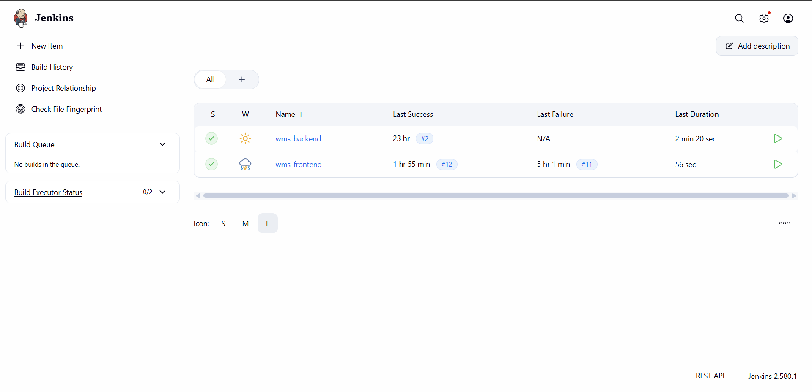

| Backend pipeline | Frontend pipeline |
|---|---|
| 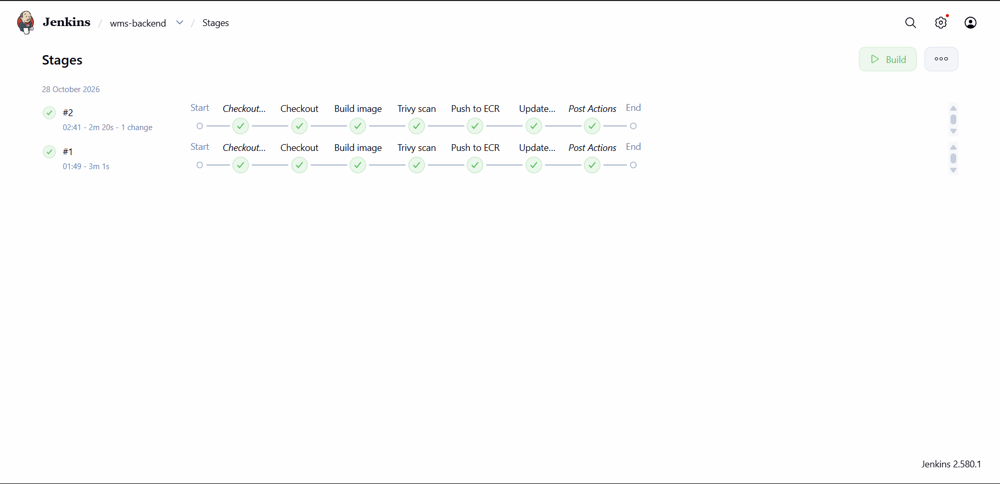 | 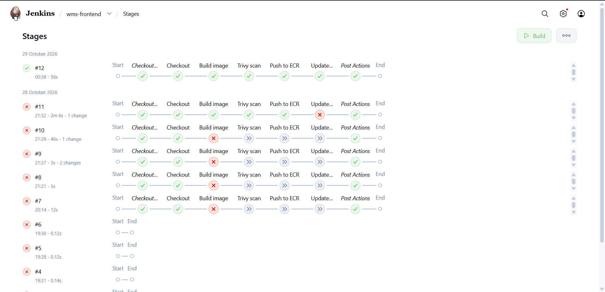 |

Images are stored in ECR, tagged with the Jenkins build number:

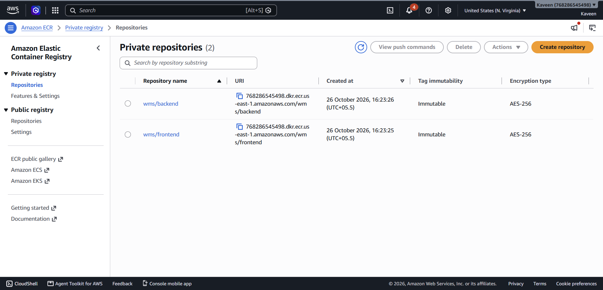

## AWS resources

| | |
|---|---|
| 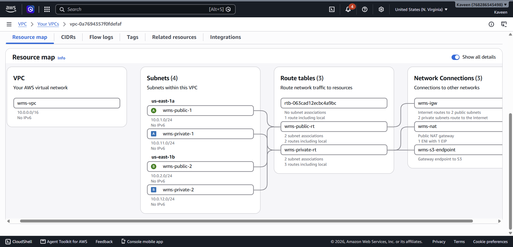 |  |
|  | 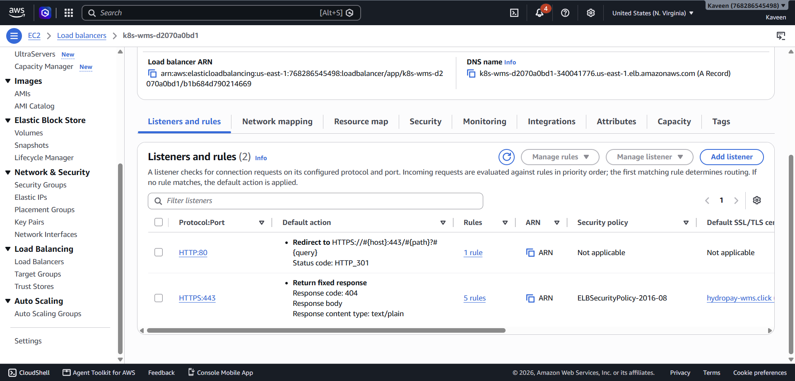 |
| 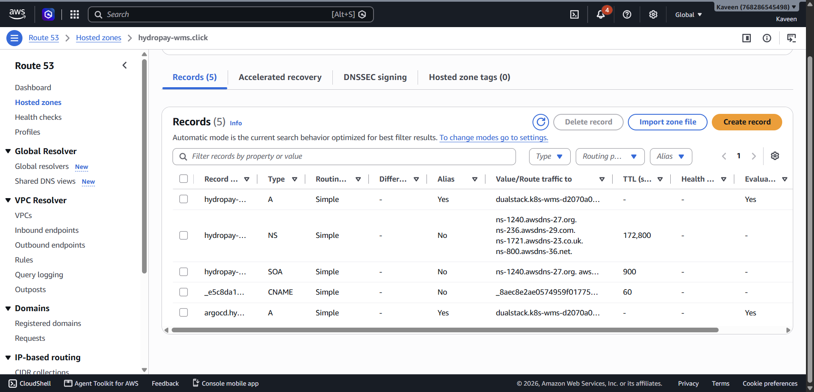 | 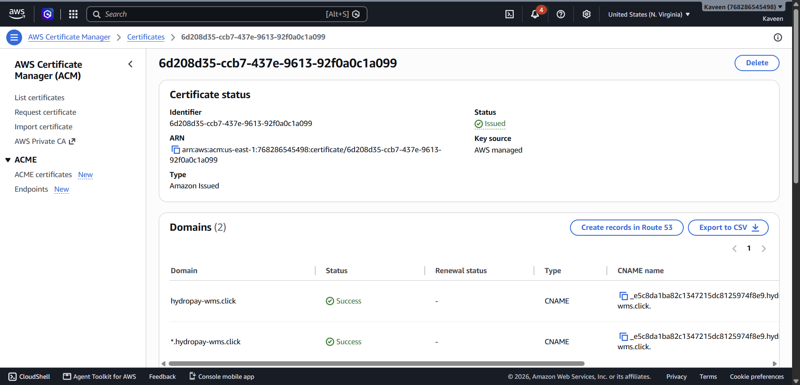 |

## Domain and HTTPS

I bought `hydropay-wms.click` from Namecheap (a cheap `.click` domain, enough for a practice project) and delegated it to AWS:

1. I created a Route 53 hosted zone for the domain in the AWS console. It is not managed by Terraform, which reads it as a `data` source.
2. At Namecheap I switched the domain from the default DNS to Custom DNS and entered the four Route 53 nameservers, then checked with `nslookup -type=NS hydropay-wms.click 8.8.8.8`.
3. Terraform requests an ACM certificate for the domain and `*.hydropay-wms.click`, validated automatically through DNS records it adds to the zone.
4. The AWS Load Balancer Controller creates the ALB from the Ingress, and alias records point `hydropay-wms.click` and `argocd.hydropay-wms.click` at it.

A stable domain matters because GitHub webhooks need a fixed public URL, and ACM cannot issue a certificate for a load balancer's own hostname.

## Monitoring and logging

Grafana dashboards from kube-prometheus-stack show pod, node and cluster CPU and memory:

| Pods (`wms` namespace) | Nodes | Cluster |
|---|---|---|
| 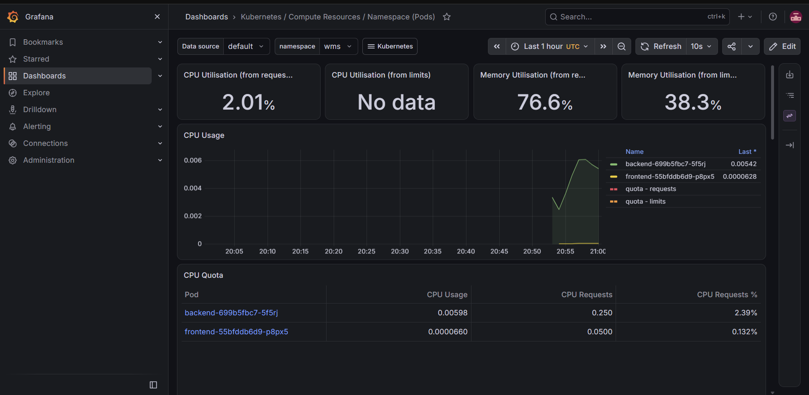 | 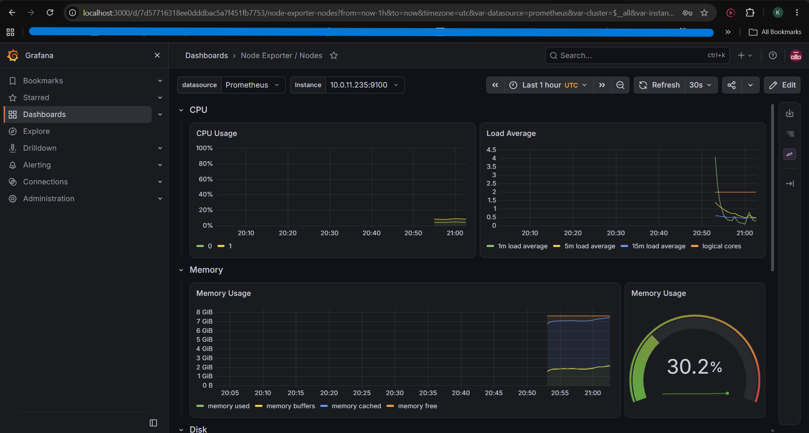 | 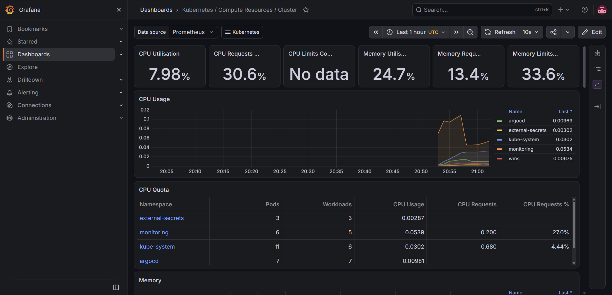 |

Filebeat ships the `wms` container logs to Elasticsearch, and Kibana is used to search them. Reading the backend logs this way is how I spotted the app's chatty scheduler and its SMS gateway warnings.

| Backend logs in Kibana | Log volume per container |
|---|---|
| 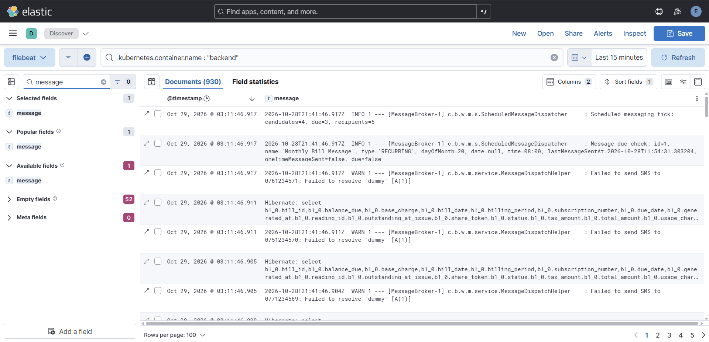 | 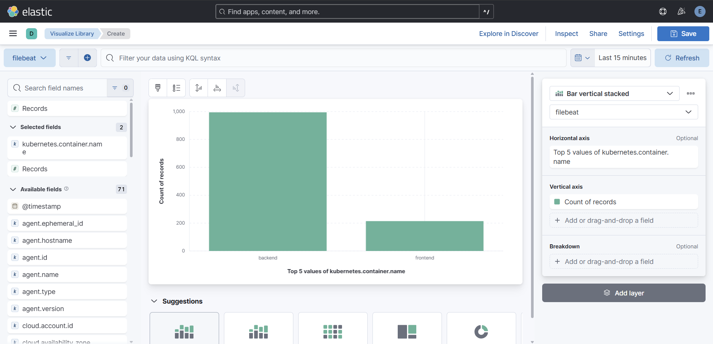 |

## Design decisions

- **GitOps for the app, Terraform for the platform.** Terraform owns cloud resources, and Git plus ArgoCD owns what runs in the cluster.
- **Secrets never in Git.** The database credentials live in Secrets Manager, and an ExternalSecret turns them into a Kubernetes secret.
- **Private database.** RDS has no public access, and only the cluster can reach it.
- **One ALB.** Both the app and the ArgoCD webhook share a single load balancer through an ingress group.
- **Only the ArgoCD webhook is public.** The ArgoCD UI is reached with `kubectl port-forward`.
- **Webhook instead of polling.** GitHub notifies Jenkins and ArgoCD directly, so a change reaches the cluster within a minute or two rather than waiting for the default 3-minute poll.

## Problems I hit and fixed

- ArgoCD's `prune: true` deleted the live Ingress (and its ALB) when I committed an incomplete `ingress.yaml`. I restored the file and re-pointed DNS to the new ALB.
- The backend crash-looped because it defaulted to the `dev` Spring profile. I set `SPRING_PROFILES_ACTIVE=prod` in the deployment manifest.
- The frontend build failed on a lockfile created on Windows (platform-specific optional dependencies). The Dockerfile now installs from `package.json`.
- The frontend API URL is baked in at build time by Vite, so the Jenkinsfile passes it as a build argument.
- My admin IP changed several times and locked me out of Jenkins and the cluster API. The allowed CIDR is a Terraform variable.

## Known limitations

- Trivy runs in report-only mode. The latest scan reported 74 HIGH/CRITICAL findings in the backend image and 60 in the frontend image, mostly in base layers and dependencies.
- There is no automated test stage, and the app has failing tests that I left alone (this project was deployment-only).
- The frontend image installs without a lockfile, so builds are not fully reproducible.
- Elasticsearch runs as a single node with no retention policy, and Alertmanager is disabled. This is fine for a demo, not for production.
- The backend's SMS gateway host is the placeholder `dummy`, so scheduled SMS sends log warnings. That is application configuration.
- Pods have CPU and memory requests but no CPU limits.

## Cost and teardown

The cluster, NAT gateway, RDS instance and load balancer all cost money every hour they run. Before `terraform destroy`, remove what Kubernetes created outside Terraform (ingresses and their load balancers, and the persistent volumes behind Prometheus, Grafana and Elasticsearch), otherwise they are left behind and keep billing:

```
kubectl delete application wms -n argocd
kubectl delete ingress wms -n wms
kubectl delete ingress argocd-webhook -n argocd
kubectl delete -f k8s/logging.yaml
helm uninstall monitoring -n monitoring
kubectl delete pvc --all -n monitoring
kubectl delete pvc --all -n logging
terraform destroy
```
